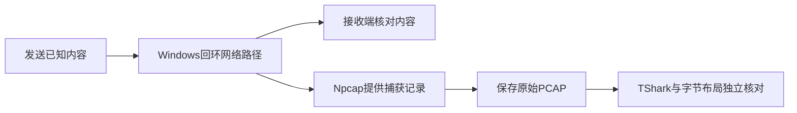

# 从通信到证据：为什么先做 A01 和 A02

这节沿着“已知输入—真实观察—独立检查”理解实验。对应 A01/A02，课程依据为实验 PDF p2–3、p5、p9、p14–15。软件是否通过测试与学习者是否理解是两件事；这里的练习用于检查后者。

## 先说明实验要保护的结论

实验1A要做带GUI的网络嗅探器。NPS（网络分组嗅探器）负责捕获观察位置可见的数据；NPA（网络协议分析器）负责解释这些数据。看见三个包只能说明某次观察收到了三个记录，不能说明所有字段解释正确，更不能说明能看见整个互联网。

程序是磁盘上的指令文件；进程是正在运行的程序实例。socket（套接字）是程序向操作系统申请的通信接口。IP地址帮助定位通信端点所在的网络位置，端口进一步区分接收通信的服务或端点。127.0.0.1是本机回环地址。本机回环通信经过操作系统网络路径，但不需要经无线网卡离开电脑。

A01实际在一个进程内创建了发送、接收两个UDP socket，并观察同一通信。它没有要求两个独立进程。UDP按数据报发送消息；发送调用成功，主要说明本机接受了这次发送，接收端仍需另行检查。

## 为什么要控制输入

如果不知道发送了什么，捕获后就很难判断少了、错了或混入了什么。我们从固定内容、固定条数、本机端点开始，降低外部服务器和网络故障的干扰。

设计路径（表示逻辑角色，不代表不同进程）：

A01证据目录中的 sent、received、captured 分别记录发送调用、接收端、捕获读取的结果。三项分别检查，是为了定位失败发生在哪条路径。未来若用独立客户端和服务器，逻辑关系仍然成立。

## 字节怎样变成可检查材料

一个字节是8个二进制位。十六进制每两位常用于表示一个字节。我们发送的25字节文字，还会配有网络层和传输层的头部。头部是按协议规定排列的字段，记录地址、长度和类型等信息。

本次回环样本：4字节DLT_NULL头 + 20字节IPv4头 + 8字节UDP头 + 25字节载荷 = 57字节。57是这条捕获记录的数据长度，不是整个PCAP文件大小。PCAP还保存文件格式、时间与记录长度。

DLT_NULL与Ethernet是两种不同的捕获记录布局。前者在本次环境有4字节头，后者常见基础头为14字节。解析前必须读取链路类型；不能先背一个偏移再套给所有输入。

## A02为什么必须先写预期

fixture是可重复使用的固定测试输入。为每个fixture保存原始PCAP、生成方式、文件哈希和expected。expected来自协议布局、生成端已知内容与独立工具核查，不能简单复制被测程序的输出。

哈希是文件内容的指纹。相同哈希帮助确认“这次和上次比较的是同一份文件”，不证明该文件内容正确或授权合规。生成器变化时应创建新版本样本，不覆盖历史输入。

建议先挑一帧手算，再增加Ethernet、IPv6、TCP、ICMP、HTTP和边界样本。正常报文回答“能否做对”；负例回答“什么情况下会承认无法完整解释”。

## 如何展示而不夸大

报告放一张逻辑路径图和一张证据表。PPT用一条消息说明 sent、received、captured 为什么不同。现场演示先说明发送内容，再观察捕获记录。截图必须包含接口、过滤条件、选中帧及状态；原始图片与标注图片分开存。

A01的Qt图片只说明隐藏控件能被绘制。它不是实时抓包GUI验收，也不证明捕获与展示之间已联动。

## 你怎样审查这一阶段

1. 输入是否可控，预期是否在运行前写好？
2. 是否把通信接收与捕获观察分开检查？
3. 能否从截图回到同一份PCAP和具体帧？
4. 失败和未知是否也保留了运行目录？

> [!example]- 自测：sent=3、received=3、captured=0
> 优先检查捕获路径：接口是否是回环、过滤端口是否与本次动态端口一致、句柄是否成功打开、读取是否在正确时间发生。不能只凭这一组数字指责发送端，也不能直接断言是Npcap驱动缺陷。接收成功并不意味着观察路径成功。

补充来源：[Npcap API](https://npcap.com/guide/wpcap/pcap.html)，本工程运行时1.83/SDK1.17；[IPv4 RFC791](https://www.rfc-editor.org/rfc/rfc791)。
