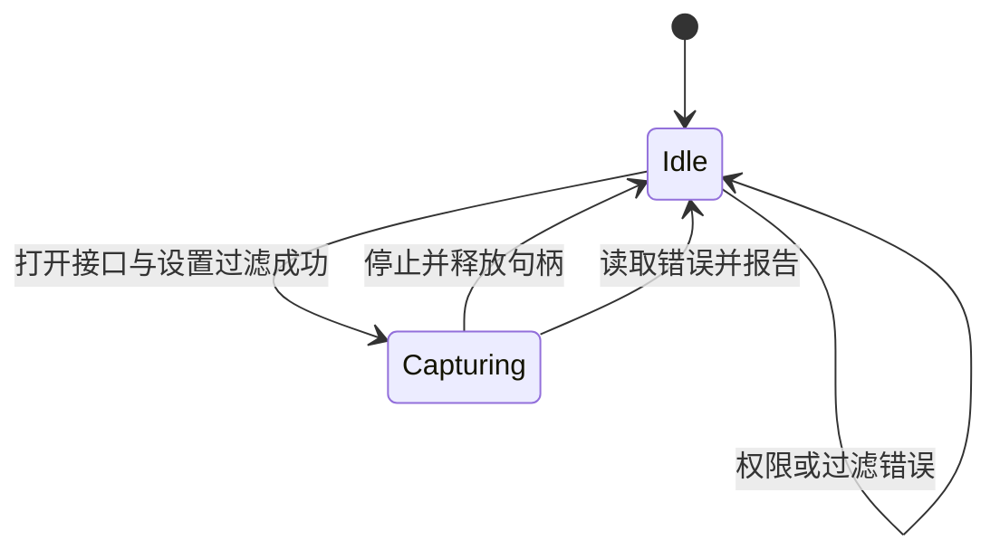

# 捕获路径与生命周期：A03 怎样证明真实抓包

这节先确定观察位置，再解释接口打开、读取、保存与停止。课程依据：PDF p5、p9、p15。只有离线PCAP回放不能验收真实NPS能力。

## 为什么抓包需要选择接口

网卡连接电脑与某个网络；回环、虚拟机适配器和VPN也可能提供捕获接口。接口列表不是同一份数据的不同名字。选择WLAN时不能假定看见本机回环通信；选择回环时也不能假定看见另一台机器的所有流量。

Npcap提供驱动和用户态API。应用调用API，驱动在支持的位置取得记录。网络嗅探不等于绕过交换机、VPN或加密。即便成功看到加密流量，也不代表能还原其中的应用明文。

## 句柄为什么要有清晰生命周期

句柄可以理解为程序持有的一次捕获会话。典型状态为：未打开、已打开、正在读取、已停止、已关闭。每次创建都要有对应的释放。错误路径同样需要关闭句柄，否则反复启停可能泄漏资源。

运行时先确认DLL来自Npcap，而非历史WinPcap。再枚举接口，打开目标，记录pcap_datalink返回的链路类型。抓到的内存可能由库管理，因此如果要稍后展示，必须复制到应用拥有的存储，不能把临时指针永久保存。

## 为什么捕获过滤要在入口设置

捕获过滤决定哪些记录进入后续处理，例如 `udp and port 9000`。它降低后续处理量，但被排除的记录无法靠后续显示过滤找回来。过滤表达式必须编译成功；错误表达式应报错，而不能静默变成“全抓”。

最小验收使用自己的唯一载荷标记，并限制到本机端点和测试端口。这样可以把捕获记录对应到发送日志，也避免采集无关通信。

## 保存与停止分别要验证什么

保存成功需要文件可被独立工具重新打开，并核对时间、长度、链路类型和载荷。文件存在且大小大于零仍可能只包含文件头，所以不能作为唯一成功判据。

停止应结束当前捕获活动并释放资源。界面上按钮变灰不能单独证明停止完成。还应观察停止事件、后续计数与句柄状态。空闲接口无包时也必须能停，否则实现可能被阻塞读取卡住。

## 报告和演示的具体安排

保留开始前的接口选择截图、发送端日志、原始PCAP和停止后的状态截图。录屏按“版本与接口—开始—产生受控流量—选择一帧—停止”展开。一个错误过滤表达式可以用来展示程序拒绝无效配置并允许修正重试。

不能用预制文字页面冒充实时抓包。离线模式可以用于重复讲解，但需在画面与图注明确标为离线输入。

## 你怎样判断实现合理

先看所有失败是否显式可见，再看资源是否释放，最后看真实记录是否对应受控通信。只有在这条路径稳定后才值得增加更多协议。

> [!example]- 自测：换了接口后突然抓不到包，应怎样排查？
> 先确认被观察的通信实际经过哪个接口。再核对过滤条件和端点，最后检查权限及读取错误。不要通过开启全网扫描来掩盖观察点不清的问题。

补充来源：[Npcap捕获API](https://npcap.com/guide/wpcap/pcap.html)。本工程使用Windows/Npcap路径；Linux的netfilter、BPF/eBPF属于课件背景，不是本实现的必做功能。
